https://github.com/NXGHTMXRE007/web1

# Лабораторная работа №2. Модели. CRUD

**Студент:** Евдокимов Иван Александрович
**Группа:** ПИЖ-б-о-25-2(1)
**Вариант 9**
## Цель работы
Разработка моделей, научиться проводить миграцию
данных, работа с базой данных

## Выполнение практического  задания
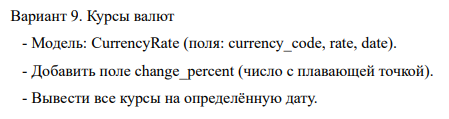

Создана модель:  
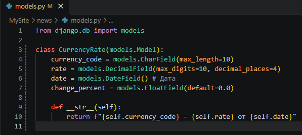  
Выполнил команду для создания миграций и применил миграции к базе данных:  
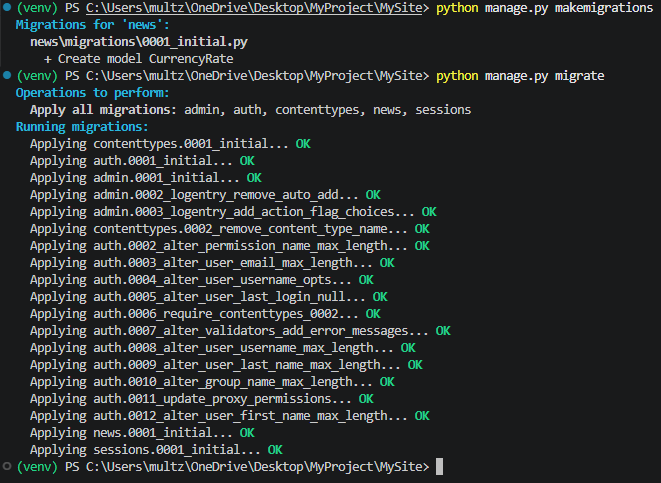  
Подключение базы данных к SQLiteStudio:  
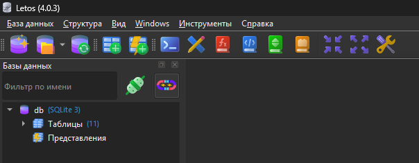  
Запустил консоль Django в терминале:  
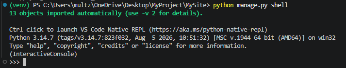   
Импортировал созданную модель:  
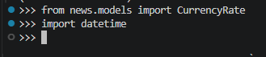  
Добавил несколько курсов валют:  
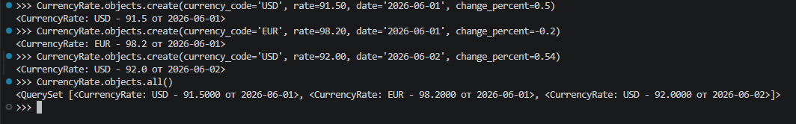  
Вывел все курсы на определённую дату:  
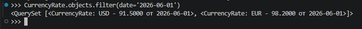  
Получил конкретную запись и изменил её поле:  
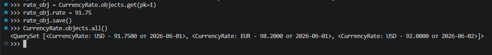  

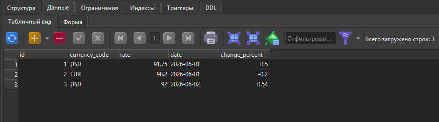  
Удалил запись:  
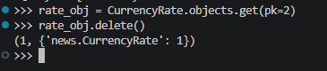  
   
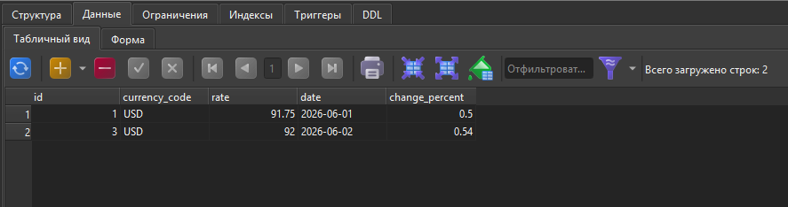  

Контрольные вопросы
1. Что такое модель в Django и для чего она используется?
Это класс, который представляет слой данных и соответствует одной таблице в базе данных; используется для хранения и предоставления информации.   
2. Какие типы полей вы знаете? Приведите примеры.
CharField (строка фиксированной длины), TextField (текст большого объема), DateTimeField (дата и время), ImageField (изображения), BooleanField (логическое True/False).   
3. Чем отличаются параметры blank=True и null=True?
blank=True разрешает оставлять поле пустым в формах (валидация), а null=True позволяет базе данных хранить значение NULL для этого столбца.   
4. Что такое миграции и зачем они нужны? Опишите основные команды для работы с ними.
Миграции — это способ отслеживать и автоматически применять изменения в структуре таблиц БД. Основные команды: makemigrations (создание файлов миграций), migrate (применение миграций к БД), sqlmigrate (просмотр SQL-запроса).   
5. Как создать суперпользователя для доступа к административной панели Django?С помощью команды в терминале: python manage.py createsuperuser.
6. Что такое ORM? Перечислите основные методы для выполнения операций CRUD.
ORM (Object-Relational Mapping) позволяет работать с базой данных через Python-код без написания SQL. Основные методы CRUD: create(), all(), filter(), get(), update (через изменение атрибутов и save()), delete().   
7. В чем разница между методами filter() и get()?
Метод filter() возвращает набор записей (QuerySet), удовлетворяющих условию (может вернуть несколько или ни одной), а get() возвращает строго один объект (если ничего не найдено или найдено больше одного — возникает исключение).   
8. Как настроить загрузку изображений (медиафайлов) в проекте Django?
Задать в settings.py параметры MEDIA_ROOT и MEDIA_URL, а также прописать маршрут обслуживания файлов через static() в корневом urls.py в режиме отладки.   
9. Для чего нужен метод str в модели?
Для возврата строкового представления объекта модели (например, его заголовка), чтобы в консоли и админке отображалось понятное имя вместо стандартного <Model object>.   
10. Что произойдёт, если выполнить python manage.py makemigrations, но не выполнить migrate?
Django создаст файл миграции с описанием изменений в коде, но сами изменения не применятся к реальной базе данных, и таблицы не обновятся.
